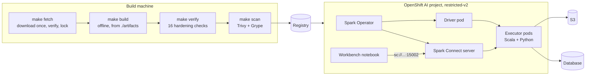

# Hardened Apache Spark images for OpenShift AI

Build a custom Apache Spark image that survives a security review and runs on OpenShift AI
under the default `restricted-v2` SCC. Every claim on this page links to the output that
proves it.

> [!NOTE]
> **The 30-second version**
>
> - **One image, every role:** `spark-submit` driver, Scala and Python executors, Spark Connect server.
> - **Two bases to choose from:** Red Hat Hardened Images (default) or UBI 9 minimal.
> - **Hardening is checked, not assumed:** 16 automated checks. A regular UBI build passes 9.
> - **Scan findings drop from 790 to 114** (hardened base) compared with a regular UBI build.
> - **It runs with no SCC granted:** tested on OpenShift 4.20 with OpenShift AI 3.5.4.
> - **"Zero vulnerabilities" is not reached.** What is left has no fixed version yet. [Details](docs/scan-comparison.md#what-is-still-open).

## Contents

- [Pick your path](#pick-your-path)
- [What is in the image](#what-is-in-the-image)
- [Architecture](#architecture)
- [Requirements](#requirements)
- [Quick start: build and check](#quick-start-build-and-check)
- [Quick start: run on OpenShift AI](#quick-start-run-on-openshift-ai)
- [Results](#results)
- [Requirement checklist](#requirement-checklist)
- [Repository layout](#repository-layout)
- [Open decisions](#open-decisions)
- [Not covered](#not-covered)
- [Additional resources](#additional-resources)

## Pick your path

| I want to... | Go to |
|---|---|
| Build it and see it work | [Quick start](#quick-start-build-and-check) below |
| Follow every step with expected output | [docs/walkthrough.md](docs/walkthrough.md) |
| Know what the hardening changed | [docs/hardening.md](docs/hardening.md) |
| See scan numbers before and after | [docs/scan-comparison.md](docs/scan-comparison.md) |
| Choose between the hardened base and UBI 9 | [docs/choosing-a-base.md](docs/choosing-a-base.md) |
| Run it on OpenShift AI, or fix a job that fails there | [docs/openshift-ai.md](docs/openshift-ai.md) |
| Check the raw output behind a number | [docs/evidence/](docs/evidence/) |

## What is in the image

| | |
|---|---|
| Spark | 4.3.0 (Scala 2.13), Spark Connect included |
| Java / Python | OpenJDK 21 headless / Python 3.12 with numpy, pandas, pyarrow, grpcio |
| Storage | S3 through `hadoop-aws` 3.5.0 and the AWS SDK v2 |
| Databases | PostgreSQL, SQL Server and Oracle JDBC drivers |
| Base | Red Hat Hardened Images (`spark-hi`) or UBI 9 minimal (`spark-ubi9`) |
| Default user | `1001:0`, and works as any UID in group 0 |

## Architecture



## Requirements

**Build machine**

- `podman`, `make`, `curl`, `gpg`
- `python3` with `pip`
- Internet access, or internal mirrors, for `make fetch` only

**Cluster**

- OpenShift 4.x with OpenShift AI 3.5 or later
- The **Spark Operator** component set to `Managed` in the `DataScienceCluster`

**Permissions**

- Cluster administrator, once, to enable the Spark Operator component
- Project administrator for everything else
- **No SCC grants.** If a step asks you to run `oc adm policy add-scc-to-user`, something is wrong.

## Quick start: build and check

**Procedure**

1. Download and lock the inputs. This is the only step that uses the network.

   ```bash
   make fetch
   ```

2. Build the image from `./artifacts`.

   ```bash
   make build            # add FLAVOR=ubi9 for the UBI 9 base
   ```

3. Run the hardening checks.

   ```bash
   make verify
   ```

4. Run the functional tests.

   ```bash
   make test
   ```

5. Scan the image.

   ```bash
   make scan
   ```

**Verification**

- `make verify` ends with `== 16 passed, 0 failed`.
- `make test` ends with `== 11 passed, 0 failed`.
- `make scan` writes `reports/<image>/summary.md`.

Want the before-and-after on your own machine? Run `make compare`. It builds the regular UBI
image and runs the same checks and scans against both.

## Quick start: run on OpenShift AI

**Prerequisites**

- You are logged in with `oc`.
- The image is in a registry the cluster can pull from.

**Procedure**

1. Create a project. Do not grant it an SCC.

   ```bash
   oc new-project spark-demo
   oc label namespace spark-demo opendatahub.io/dashboard=true
   ```

2. Push the images.

   ```bash
   make push
   ```

3. Run the three cluster tests.

   ```bash
   IMG=<registry>/spark-hi:4.3.0-3

   tests/cluster-test-openshift-ai.sh "$IMG"
   examples/run-cluster.sh "$IMG" <registry>/spark-examples:4.3.0-3
   tests/security-cluster.sh "$IMG"
   ```

**Verification**

Each script ends with a count and lists the SCC and UID of every Spark pod:

```
  PASS all 6 Spark pods admitted by restricted-v2
  PASS all Spark pods run as a namespace-assigned UID
== 9 passed, 0 failed
```

**Clean up**

```bash
tests/cluster-test-openshift-ai.sh "$IMG" --cleanup
```

Private registry, workbench setup and troubleshooting: [docs/openshift-ai.md](docs/openshift-ai.md).

## Results

### Before and after

The same Spark, built the regular UBI way and built by this repo.
[Full comparison](docs/scan-comparison.md).

| | Regular UBI 9 build | This repo, UBI 9 minimal | This repo, hardened base |
|---|---|---|---|
| Grype findings | 793 | 434 | **114** |
| Trivy findings | 790 | 425 | 55 ¹ |
| Critical (Trivy) | 4 | 0 | 0 |
| Java-library findings (Trivy) | 187 | 55 | 55 |
| OS packages installed | 213 | 139 | 78 |
| Hardening checks passed | 9 / 16 | 16 / 16 | 16 / 16 |
| Downloads software during the build | yes | no | no |
| Ships `pip` and build caches | yes | no | no |
| Runtime user can modify Spark's jars | yes | no | no |

¹ Trivy does not recognise the hardened base's operating system and skips its packages. That
number is Java libraries only. Use the Grype row to compare.

### Tests on OpenShift AI

OpenShift 4.20.27, OpenShift AI 3.5.4, 2026-11-25. [Details](docs/openshift-ai.md).

| Test | `spark-hi` | `spark-ubi9` |
|---|---|---|
| Operator: `SparkApplication` and `SparkConnect` | ✅ 9 / 9 | ✅ 9 / 9 |
| Example pipeline through the operator | ✅ 5 / 5 | ✅ 5 / 5 |
| Cluster security: NetworkPolicy, RBAC, credentials | ✅ 10 / 10 | ✅ 10 / 10 |
| `spark-submit` without the operator | ✅ 8 / 8 | not run |
| Notebook in a real workbench | not run | ✅ pass |

## Requirement checklist

| | Requirement | How it is met | Proof |
|---|---|---|---|
| ✅ | Spark Connect and `spark-submit` | [`image/entrypoint.sh`](image/entrypoint.sh) modes `driver`, `executor`, `connect` | Operator test 9 / 9 |
| ✅ | Scala and Python executors | One image with the JVM, Python 3.12 and the Arrow stack | Scala SparkPi and a PySpark pandas UDF on the cluster |
| ✅ | S3 and database libraries | [`image/jars.txt`](image/jars.txt) | S3 and JDBC round-trips; three real database engines locally |
| ✅ | No secrets in the image | Nothing in git, `ENV` or layers. Credentials come from Secrets at run time | `verify-image.sh`; Trivy secret scan: 0; no credential in any spec or log |
| ✅ | Non-root default user | `USER 1001:0` | Ran as UID `1000770000` on the cluster |
| ✅ | No downloads during the build | Build copies from `./artifacts`, checked against [`artifacts.sha256`](artifacts.sha256) | `verify-image.sh` build-history check |
| ✅ | No end-of-life software | Spark 4.3.0, OpenJDK 21, Python 3.12; ten bundled library families replaced | [`image/jars.txt`](image/jars.txt), scan reports |
| ✅ | `restricted-v2` compatible | No fixed UID, all capabilities dropped, no privilege escalation, `RuntimeDefault` seccomp | Every Spark pod admitted by `restricted-v2`, no SCC granted |
| ❌ | Zero vulnerabilities | **Not met.** 55 Java-library findings plus OS findings, none with a fix available | [docs/scan-comparison.md](docs/scan-comparison.md#what-is-still-open) |

## Repository layout

```
versions.env            pinned versions, base images, registry and tag
artifacts.sha256        SHA-256 lock for every vendored binary
Containerfile           hardened-image flavour (FROM scratch + minimal RPM root filesystem)
Containerfile.ubi9      UBI 9 minimal flavour
baseline/               the regular UBI build, for comparison only
image/                  what goes in the image: assemble script, jar lists, entrypoint, defaults
hack/                   fetch-artifacts.sh, verify-image.sh, scan.sh
tests/                  local and cluster tests
deploy/openshift-ai/    SparkApplication, SparkConnect, RBAC and NetworkPolicy for OpenShift AI
deploy/                 the same without the operator (plain spark-submit)
examples/               three example projects and their manifests
docs/                   the guide and the evidence
```

## Open decisions

These need an owner. None can be settled inside the image build.

| # | Decision | Options |
|---|---|---|
| 1 | Shaded-library findings (51) | Rebuild Spark and the Hadoop client from source, re-shade the jars, or record VEX justifications |
| 2 | Hive 2.3 jars (4 findings) | Remove them and lose Hive Metastore support, or keep them |
| 3 | Which base to lead with | Depends on whether your scanner recognises the hardened images. [Guide](docs/choosing-a-base.md) |
| 4 | Spark version | 4.3.0 is tested here. OpenShift AI 3.5 ships 4.0.1 in the operator and clients up to 4.2.0 |
| 5 | Oracle JDBC driver licence | Confirm it may be redistributed inside the image |

## Not covered

- Red Hat's published Spark Operator documentation was not read directly. The manifests follow
  the examples in Red Hat's operator source repository.
- The Spark Operator's support status in OpenShift AI 3.5 (generally available or Technology
  Preview) is unconfirmed.
- Disconnected clusters, FIPS mode, and architectures other than x86_64.
- Support and licensing terms of Red Hat Hardened Images.

## Additional resources

- [Red Hat build of the Kubeflow Spark Operator: source and OpenShift examples](https://github.com/red-hat-data-services/spark-operator)
- [Kubeflow Spark Operator](https://github.com/kubeflow/spark-operator)
- [Apache Spark: Running on Kubernetes](https://spark.apache.org/docs/latest/running-on-kubernetes.html)
- [Apache Spark: Spark Connect overview](https://spark.apache.org/docs/latest/spark-connect-overview.html)
- [Trivy](https://trivy.dev) and [Grype](https://github.com/anchore/grype)
