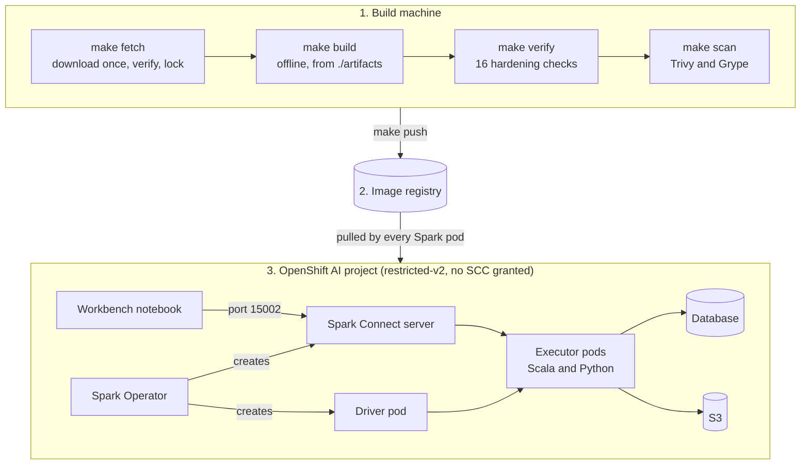

# Apache Spark on OpenShift AI: bring your own hardened image

How to run Apache Spark with Red Hat OpenShift AI: what the platform gives you, what you have
to bring, and how to build the one thing it does not ship, a Spark image. Tested on
OpenShift 4.20 with OpenShift AI 3.5.4.

> [!NOTE]
> **In short**
>
> - **OpenShift AI gives you the Spark Operator and workbenches. You bring the Spark image.**
> - **One image, every role:** `spark-submit` driver, Scala and Python executors, Spark Connect server.
> - **Three starting points compared:** Red Hat Hardened Images (default), UBI 9 minimal, and the Docker Hub image.
> - **Safer by default:** 793 scan findings in a regular UBI build, 434 on UBI 9 minimal, **92** on the hardened base.
> - **No SCC needed:** every pod runs under the default `restricted-v2`.
> - **Four Spark versions tested** against OpenShift AI 3.5.4: 4.0.5, 4.1.4, 4.2.1 (default) and 4.3.0.

## Contents

- [Start here](#start-here)
- [What is in the image](#what-is-in-the-image)
- [Architecture](#architecture)
- [Requirements](#requirements)
- [Quick start: build and check](#quick-start-build-and-check)
- [Quick start: run on OpenShift AI](#quick-start-run-on-openshift-ai)
- [Results](#results)
- [Requirement checklist](#requirement-checklist)
- [Repository layout](#repository-layout)
- [Choices made in this repo](#choices-made-in-this-repo)
- [Not covered](#not-covered)
- [Additional resources](#additional-resources)

## Start here

| I want to... | Go to |
|---|---|
| Understand what OpenShift AI provides and what I must bring | [docs/spark-on-openshift-ai.md](docs/spark-on-openshift-ai.md) |
| Bring my own image: hardened, UBI 9 or Docker Hub? | [docs/bring-your-own-image.md](docs/bring-your-own-image.md) |
| Know which Spark and client versions work together | [docs/compatibility.md](docs/compatibility.md) |
| Build it and see it work | [Quick start](#quick-start-build-and-check) below |
| Follow every step with expected output | [docs/walkthrough.md](docs/walkthrough.md) |
| Know what the hardening changed | [docs/hardening.md](docs/hardening.md) |
| See scan numbers before and after | [docs/scan-comparison.md](docs/scan-comparison.md) |
| Run it on OpenShift AI, or fix a job that fails there | [docs/openshift-ai.md](docs/openshift-ai.md) |
| Read the test logs and scan reports | [docs/results/](docs/results/) |

## What is in the image

| | |
|---|---|
| Spark | 4.2.1 (Scala 2.13), Spark Connect included. [Other tested versions](docs/compatibility.md) |
| Java / Python | OpenJDK 21 headless / Python 3.12 with numpy, pandas, pyarrow, grpcio |
| Storage | S3 through `hadoop-aws` 3.5.0 and the AWS SDK v2 |
| Databases | PostgreSQL and SQL Server JDBC drivers. Oracle is [one line to add](docs/bring-your-own-image.md#make-it-yours) |
| Base | Red Hat Hardened Images (`spark-hi`) or UBI 9 minimal (`spark-ubi9`) |
| Default user | `1001:0`, and works as any UID in group 0 |

## Architecture



Use the controls on the diagram to zoom, pan or open it full screen.

1. **Build machine:** fetch once, build offline, check, scan.
2. **Registry:** `make push` puts the image there; every Spark pod pulls it.
3. **OpenShift AI project:** the Spark Operator creates driver pods and the Spark Connect server. Both start executors, which read and write S3 and the database. A workbench notebook talks to Spark Connect on port 15002.

## Requirements

**Build machine**

- `podman`, `make`, `curl`, `gpg`
- `python3` with `pip`
- Internet access, or internal mirrors, for `make fetch` only

**Cluster**

- OpenShift 4.x with OpenShift AI 3.5 or later
- The **Spark Operator** component set to `Managed` in the `DataScienceCluster`

**Permissions**

- Cluster administrator, once, to enable the Spark Operator component
- Project administrator for everything else
- **No SCC grants.** If a step asks you to run `oc adm policy add-scc-to-user`, something is wrong.

## Quick start: build and check

**Procedure**

1. Download and lock the inputs. This is the only step that uses the network.

   ```bash
   make fetch
   ```

2. Build the image from `./artifacts`.

   ```bash
   make build            # add FLAVOR=ubi9 for the UBI 9 base
   ```

3. Run the hardening checks.

   ```bash
   make verify
   ```

4. Run the functional tests.

   ```bash
   make test
   ```

5. Scan the image.

   ```bash
   make scan
   ```

**Verification**

- `make verify` ends with `== 16 passed, 0 failed`.
- `make test` ends with `== 11 passed, 0 failed`.
- `make scan` writes `reports/<image>/summary.md`.

To compare with a regular UBI build, run `make compare`. It builds the regular UBI
image and runs the same checks and scans against both.

## Quick start: run on OpenShift AI

**Prerequisites**

- You are logged in with `oc`.
- The image is in a registry the cluster can pull from.

**Procedure**

1. Create a project. Do not grant it an SCC.

   ```bash
   oc new-project spark-demo
   oc label namespace spark-demo opendatahub.io/dashboard=true
   ```

2. Push the images.

   ```bash
   make push
   ```

3. Check that the cluster, the project and the image are ready.

   ```bash
   IMG=<registry>/spark-hi:4.2.1-2

   hack/preflight.sh "$IMG"
   ```

4. Run the three cluster tests.

   ```bash
   tests/cluster-test-openshift-ai.sh "$IMG"
   examples/run-cluster.sh "$IMG" <registry>/spark-examples:4.2.1-2
   tests/security-cluster.sh "$IMG"
   ```

**Verification**

`hack/preflight.sh` ends with `0 failed`. Each test script ends with a count and lists the SCC and UID of every Spark pod:

```
  PASS all 6 Spark pods admitted by restricted-v2
  PASS all Spark pods run as a namespace-assigned UID
== 9 passed, 0 failed
```

**Clean up**

```bash
tests/cluster-test-openshift-ai.sh "$IMG" --cleanup
```

Private registry, workbench setup and troubleshooting: [docs/openshift-ai.md](docs/openshift-ai.md).

## Results

### Before and after

The same Spark 4.2.1 from four sources. Scanned 2026-11-26.
[Full comparison](docs/scan-comparison.md).

| | Docker Hub `apache/spark` | Regular UBI 9 build | This repo, UBI 9 minimal | This repo, hardened base |
|---|---|---|---|---|
| Grype findings | 1,279 | 793 | 434 | **92** |
| Trivy findings | 3,419 | 790 | 425 | 55 ¹ |
| Critical (Trivy) | 33 | 4 | 0 | 0 |
| Java-library findings (Trivy) | 140 | 187 | 55 | 55 |
| OS packages installed | 265 | 213 | 139 | 78 |
| Hardening checks passed | 7 / 16 | 9 / 16 | 16 / 16 | 16 / 16 |
| S3 and JDBC libraries included | no | yes | yes | yes |
| Downloads software during the build | not applicable | yes | no | no |
| Runtime user can modify Spark's jars | yes | yes | no | no |

¹ Trivy does not recognise the hardened base's operating system and skips its packages. That
number is Java libraries only. Use the Grype row to compare.

The findings that remain have no fixed release to move to yet:
[what is left and why](docs/scan-comparison.md#what-is-left).

### Tests on OpenShift AI

OpenShift 4.20.27, OpenShift AI 3.5.4, Spark 4.2.1, 2026-11-26. [Details](docs/openshift-ai.md).

| Test | `spark-hi` | `spark-ubi9` |
|---|---|---|
| Operator: `SparkApplication` and `SparkConnect` | ✅ [9 / 9](docs/results/openshift/4.2.1-hi-operator.log) | ✅ [9 / 9](docs/results/openshift/4.2.1-ubi9-operator.log) |
| Example pipeline through the operator | ✅ [5 / 5](docs/results/openshift/4.2.1-hi-examples.log) | ✅ [5 / 5](docs/results/openshift/4.2.1-ubi9-examples.log) |
| Cluster security: NetworkPolicy, RBAC, credentials | ✅ [10 / 10](docs/results/openshift/4.2.1-hi-security.log) | ✅ [10 / 10](docs/results/openshift/4.2.1-ubi9-security.log) |
| `spark-submit` without the operator | ✅ [8 / 8](docs/results/openshift/4.2.1-hi-native.log) | ✅ [8 / 8](docs/results/openshift/4.2.1-ubi9-native.log) |
| Notebook clients, 7 versions | ✅ [7 / 7](docs/results/openshift/4.2.1-hi-clients.log) | ✅ [7 / 7](docs/results/openshift/4.2.1-ubi9-clients.log) |
| Notebook in a workbench | ✅ [1 / 1](docs/results/openshift/4.2.1-hi-workbench.log) | ✅ [1 / 1](docs/results/openshift/4.2.1-ubi9-workbench.log) |

### Spark versions tested

Hardened image, same cluster. Logs and the client matrix:
[docs/compatibility.md](docs/compatibility.md).

| Spark | Operator | `spark-submit` without the operator | Notebook clients passing |
|---|---|---|---|
| 4.0.5 | ✅ 9 / 9 | ✅ 8 / 8 | ✅ 7 / 7 |
| 4.1.4 | ✅ 9 / 9 | ✅ 8 / 8 | ✅ 7 / 7 |
| **4.2.1** (default) | ✅ 9 / 9 | ✅ 8 / 8 | ✅ 7 / 7 |
| 4.3.0 | ✅ 9 / 9 | ✅ 8 / 8 | ✅ 7 / 7 |

## Requirement checklist

| | Requirement | How it is met | Checked by |
|---|---|---|---|
| ✅ | Spark Connect and `spark-submit` | [`image/entrypoint.sh`](image/entrypoint.sh) modes `driver`, `executor`, `connect` | Operator test 9 / 9 |
| ✅ | Scala and Python executors | One image with the JVM, Python 3.12 and the Arrow stack | Scala SparkPi and a PySpark pandas UDF on the cluster |
| ✅ | S3 and database libraries | [`image/jars.txt`](image/jars.txt) | S3 and JDBC round-trips on the cluster; PostgreSQL and SQL Server engines locally |
| ✅ | No secrets in the image | Nothing in git, `ENV` or layers. Credentials come from Secrets at run time | `verify-image.sh`; Trivy secret scan: 0; no credential in any spec or log |
| ✅ | Non-root default user | `USER 1001:0` | Ran as UID `1000770000` on the cluster |
| ✅ | No downloads during the build | Build copies from `./artifacts`, checked against [`artifacts.sha256`](artifacts.sha256) | `verify-image.sh` build-history check |
| ✅ | No end-of-life software | Spark 4.2.1, OpenJDK 21, Python 3.12; ten bundled library families replaced | [`image/jars.txt`](image/jars.txt), scan reports |
| ✅ | `restricted-v2` compatible | No fixed UID, all capabilities dropped, no privilege escalation, `RuntimeDefault` seccomp | Every Spark pod admitted by `restricted-v2`, no SCC granted |
| ✅ | Security scanning | Trivy and Grype on every build, compared with a regular build and the Docker Hub image | [docs/scan-comparison.md](docs/scan-comparison.md) |

## Repository layout

```
versions.env            pinned versions, base images, registry and tag
artifacts.sha256        SHA-256 lock for every vendored binary
Containerfile           hardened-image flavour (FROM scratch + minimal RPM root filesystem)
Containerfile.ubi9      UBI 9 minimal flavour
baseline/               the regular UBI build, for comparison only
image/                  what goes in the image: assemble script, jar lists, entrypoint, defaults
compat/                 version profiles for Spark 4.0, 4.1 and 4.3
hack/                   fetch-artifacts.sh, verify-image.sh, scan.sh, preflight.sh, compat-build.sh
tests/                  local and cluster tests
deploy/openshift-ai/    SparkApplication, SparkConnect, RBAC and NetworkPolicy for OpenShift AI
deploy/                 the same without the operator (plain spark-submit)
examples/               three example projects and their manifests
docs/                   the guide, test logs and scan reports
```

## Choices made in this repo

Change any of them for your own build.

| Choice | What this repo does | To change it |
|---|---|---|
| Spark version | 4.2.1. It matches the newest client in OpenShift AI 3.5's package index (4.2.0) and has upstream's longer maintenance window | [docs/compatibility.md](docs/compatibility.md) |
| Base image | Red Hat Hardened Images by default, UBI 9 minimal as the alternative | `make build FLAVOR=ubi9` |
| Findings with no fixed release | Left as they are, listed and explained | [docs/scan-comparison.md](docs/scan-comparison.md#what-is-left) |
| Hive 2.3 support jars | Kept, so `enableHiveSupport()` and Hive Metastore work | Add them to [`image/jars-remove.txt`](image/jars-remove.txt) |
| Oracle JDBC driver | Not included. Check Oracle's licence before you add it | Uncomment one line in [`image/jars.txt`](image/jars.txt) |

## Not covered

- Which Spark versions Red Hat **supports**, and whether the Spark Operator is generally
  available or Technology Preview in your OpenShift AI version. Check Red Hat's
  supported-configurations page.
- Spark 3.5, disconnected clusters, FIPS mode, and architectures other than x86_64.
- Support and licensing terms of Red Hat Hardened Images.

## Additional resources

- [Red Hat build of the Kubeflow Spark Operator: source and OpenShift examples](https://github.com/red-hat-data-services/spark-operator)
- [Kubeflow Spark Operator](https://github.com/kubeflow/spark-operator)
- [Apache Spark: Running on Kubernetes](https://spark.apache.org/docs/latest/running-on-kubernetes.html)
- [Apache Spark: Spark Connect overview](https://spark.apache.org/docs/latest/spark-connect-overview.html)
- [Trivy](https://trivy.dev) and [Grype](https://github.com/anchore/grype)
